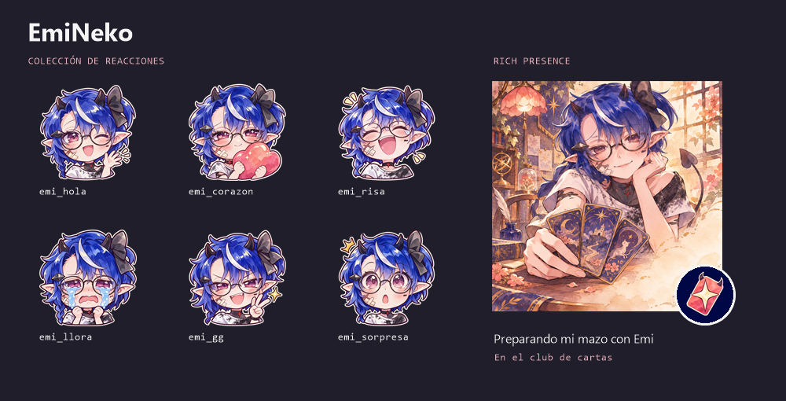

# EmiNeko

Bot de Discord en español para decidir qué jugar con amigos, organizar una reunión y cuidar una colección de cartas de anime. Guarda las bibliotecas, los votos y los recordatorios en SQLite en el equipo donde lo ejecutas. El panel `/inicio` permite recorrer sus funciones desde Discord.

**[Instalación paso a paso](PASO_A_PASO.md)** · **[Referencia de comandos](COMANDOS.md)** · **[Kit visual para Discord](assets/emineko/kit_discord/LEEME.md)**

## Empezar en Windows

Necesitas Python 3.12, una aplicación propia de Discord con bot y permiso para invitarla a un servidor. La instalación incluye el ejecutable FFmpeg utilizado para el audio.

1. Clona este repositorio o descarga y descomprime su ZIP.
2. Ejecuta `instalar.bat` en la carpeta del proyecto. Crea `.venv`, instala los paquetes y prepara `.env` desde [.env.example](.env.example).
3. Coloca el token de **tu bot** en `DISCORD_TOKEN` dentro de `.env`. En Discord Developer Portal activa **Server Members Intent** y **Message Content Intent** e instala la aplicación con `bot` y `applications.commands`. Los permisos de texto y voz están detallados en la [guía de instalación](PASO_A_PASO.md#1-instalación-desde-un-clon-limpio-windows).
4. Abre `iniciar_bot.bat`, deja la consola en ejecución y escribe `/inicio` en tu servidor. `/estado` muestra qué integraciones están configuradas.

Para probar el primer recorrido, abre `/tienda`. Verás el precio de cada sobre y tu saldo en monedas del juego. Ejecuta `/tirar` y luego `/coleccion` para localizar la carta en tu inventario. Si prefieres empezar por la biblioteca, añade un juego con `/biblioteca accion:agregar titulo:Terraria detalle:Steam`.

## Qué puedes hacer

| Actividad | Ejemplos |
|---|---|
| Elegir juego entre amigos | Importa tus títulos de Playnite con `/importar_juegos`, filtra por plataforma en `/biblioteca` y compara dos bibliotecas con consentimiento en `/encomun`. |
| Jugar al TCG de anime | Guarda distintos mazos, protege cartas, intercambia, participa en raids cooperativas y compite en la arena mensual. La tienda y el mercado utilizan moneda del juego. |
| Organizar una noche | Encuentra un horario con `/disponibilidad`, vota con `/encuesta` y crea un `/evento` con plazas y lista de espera. Los recordatorios quedan guardados entre reinicios. |
| Escuchar música o ver un video | `/play` reproduce audio en voz y `/audio` ofrece controles. La sala web opcional sincroniza un video de YouTube en los navegadores de los participantes. |
| Llevar una lista de cine y series | Guarda pendientes y progreso con `/cine`. Con TMDB configurado, busca títulos y consulta en qué plataformas aparecen para tu país. |
| Compartir fotografía | Guarda fotos privadas, consulta sus datos técnicos y participa en concursos. Inscribir una foto en un concurso permite verla a los participantes del servidor. |
| Recordar acuerdos | `/memoria` guarda notas explícitas. `/sesion` conserva texto de los participantes que aceptan y `/resumen` consulta esos registros localmente. |

## Conexiones opcionales

| Servicio | Qué debes proporcionar |
|---|---|
| Playnite | Tu exportación JSON. Para actualizarla automáticamente, copia el [puente incluido](playnite_bridge/) y ejecuta `vincular_playnite.bat` en el PC del bot. Se conserva la plataforma de cada juego exportado, incluidas Steam, Epic, GOG, Xbox e itch.io. |
| Steam | Una `STEAM_API_KEY` propia y una biblioteca visible si eliges la importación directa. Con Playnite puedes omitir esta clave. |
| TMDB | Tu **API Read Access Token** en `TMDB_TOKEN`. El acceso gratuito se utiliza para proyectos personales no comerciales, con atribución a TMDB y a JustWatch para la disponibilidad. |
| Sala de video | Habilita `EMI_WEB_ENABLED`. Para participantes remotos configura una URL accesible según la guía. Quien posea el enlace privado puede entrar hasta que la sala cierre o caduque. |

El bot se ejecuta en tu equipo y aprovecha las cuotas gratuitas de los proveedores. El acceso a un servicio externo depende de su disponibilidad, los permisos de tu cuenta y los límites de la API. Para entregar recordatorios y atender comandos, el proceso debe permanecer activo.

## Datos y mantenimiento

Una instalación nueva empieza con una biblioteca y una economía propias. El lanzador guarda copias SQLite en `backups/` cuando encuentra una base existente. Para trasladar una galería también debes copiar `data/photos/` por un medio privado. Los administradores del equipo tienen acceso a la base y a los archivos locales.

- **Diagnóstico**. Ejecuta `diagnostico.bat` para comprobar dependencias y audio. La guía describe cómo comprobar Discord y TMDB con tus propias credenciales.
- **Pruebas**. Ejecuta `verificar.bat` para probar la lógica con bases aisladas y validar los esquemas de comandos. La prueba de voz en un canal real se realiza después de instalar tu bot.
- **Privacidad**. Las claves, exportaciones de juegos, bases, fotografías, mensajes registrados, logs y copias de seguridad se mantienen fuera de Git. La [guía explica qué se excluye y cómo se genera cada archivo](PASO_A_PASO.md#qué-se-excluye-del-repositorio-y-cómo-se-obtiene).

## Créditos y licencia

**Idea y dirección del proyecto:** [SebastianDeJesusHdz2](https://github.com/SebastianDeJesusHdz2). EmiNeko nació de sus ideas para su comunidad. **El código y la documentación fueron desarrollados por Codex, el asistente de programación de OpenAI**, a partir de sus propuestas, decisiones y pruebas de uso.

El código de EmiNeko se distribuye bajo la **[Apache License 2.0](LICENSE)**. Las dependencias conservan sus respectivas licencias. Los servicios externos y los datos e imágenes obtenidos de sus catálogos están sujetos a sus propias condiciones.
